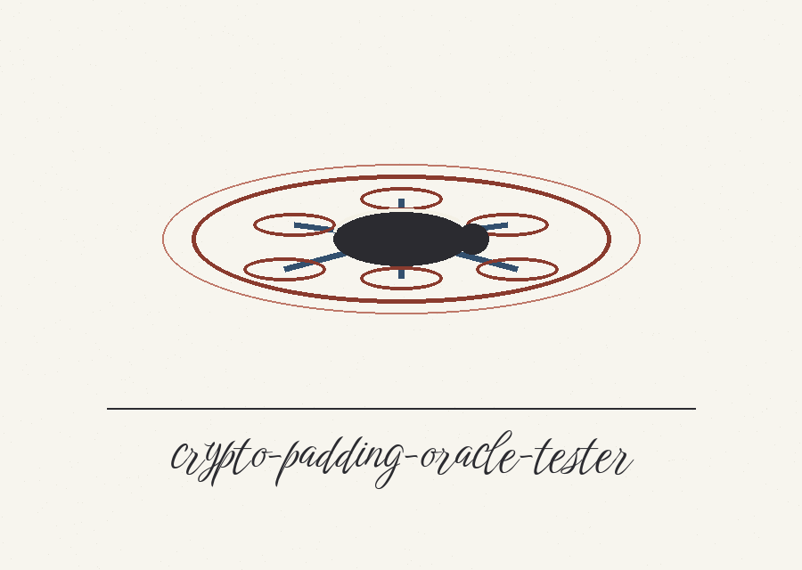
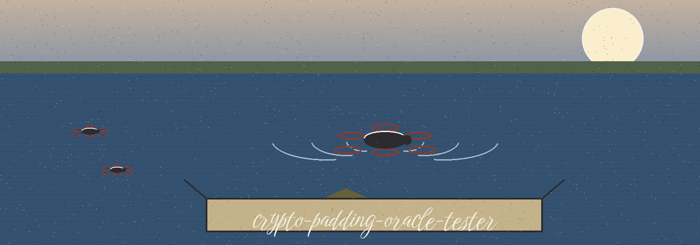

# crypto-padding-oracle-tester

Title block: the name above is set in Birthstone Bounce in swift soot on white throat, ruled beneath in soot like a field guide plate, with a small skater drawn once at the left of the first heading only.






> Keeper note, entered at first light: press, watch, press again, and learn only from how the surface answers.


# crypto-padding-oracle-tester
A tool to test a web server or cryptographic implementation for padding oracle vulnerabilities in CBC mode encryption. Sends crafted ciphertext to the server and analyzes the response to identify vulnerabilities. Relies on the `requests` library for HTTP interaction. - Focused on Basic cryptographic operations

> Keeper note, pinned at the margin: a split in the answers at one position is the whole of the evidence; nothing else is claimed.


## Install
`git clone https://github.com/ShadowStrikeHQ/crypto-padding-oracle-tester`

> Keeper note, written after the dry walk: a walk that never touches water can hold no verdict, and the run says so itself.


## Usage
```bash
python3 main.py -u <url> [--test_mode]
```

`--test_mode` is a dry run: it builds the ciphertext and walks the byte positions without sending any request, so it cannot produce a vulnerability verdict and the run ends by saying so. A live run first sends a baseline request with the unmodified ciphertext and records the response. It reports "likely found" only when at least one byte position shows distinguishing evidence: at that position, at least one byte value answered without the error string while other byte values at the same position answered with it. A server whose answers never vary with the ciphertext cannot be reported as likely found. An HTTP error status is read as a response and checked for the error string like any other answer. Invalid keys, IVs, ciphertext, or block sizes exit 1. A run also exits 1 when the ciphertext length is not a multiple of the block size, when the ciphertext holds fewer than two blocks, or when a request fails at the transport level (connection error or timeout). The "not detected" line and exit 0 are reserved for runs that completed the byte loop without oracle evidence.

## Parameters
- `-h`: Show help message and exit
- `-u`: The URL to test for the padding oracle vulnerability.
- `-d`: No description provided
- `-c`: No description provided
- `-k`: No description provided
- `-iv`: No description provided
- `-p`: No description provided
- `-e`: No description provided
- `--block_size`: No description provided
- `--get`: Use GET request instead of POST.
- `--test_mode`: Enable test mode to not send any requests to the server

## License
Copyright (c) ShadowStrikeHQ


## Keeper facts, stated from the code

### The job, stated plainly

The tool sends crafted CBC ciphertext to a server, byte by byte, and reads the replies. A position counts as evidence when some byte values draw the error string and others at that same position do not. A server that answers alike for every value is never called likely found.

### The start line

Run it as python3 main.py with the required url option, short form u, long form url. A live run first sends the unmodified ciphertext and logs the status and whether the error text was present, then starts crafting. In test mode the tool builds the ciphertext and walks each position yet sends nothing, ends by saying no verdict is possible, and exits 0.

### Every control

Data, short d, holds the text to encrypt, and a fixed default sentence is used when it is absent. Ciphertext, short c, takes base64 and is decoded with strict validation, so stray characters end the run. Key, short k, takes hex of 16, 24 or 32 bytes, else a fresh random key is made and its hex is logged. IV, short iv, takes hex of block size length, else a fresh random IV is made and its hex is logged. Parameter, short p, names the field that carries the ciphertext, default ciphertext. Error message, short e, sets the string that marks a padding fault, default PaddingException. Block size defaults to 16. Get switches the send from POST to GET. Each send waits five seconds. Requests go as form data on POST or as query values on GET, with the ciphertext base64 encoded each time.

### Facts the surface must not hide

Padding at encryption always uses the AES block size from the library, never the block size flag. The baseline reply is logged and then never compared against later replies. The accepted byte at each position is written back into the block before earlier positions are tried, so position order matters. On a run that makes them, the random key, the random IV and the base64 ciphertext are all written to the log; that behaviour is stated here as a fact, and no value is shown anywhere in this re-skin.

### The endings

Likely found prints only on split evidence and exits 0. Not detected prints when the byte loop finishes with no split and exits 0. Bad key, bad IV, bad base64, a block size below one, a ciphertext length that is not a multiple of the block size, fewer than two blocks, and any transport fault all exit 1. The licence is MIT, as the README licence section states it.
